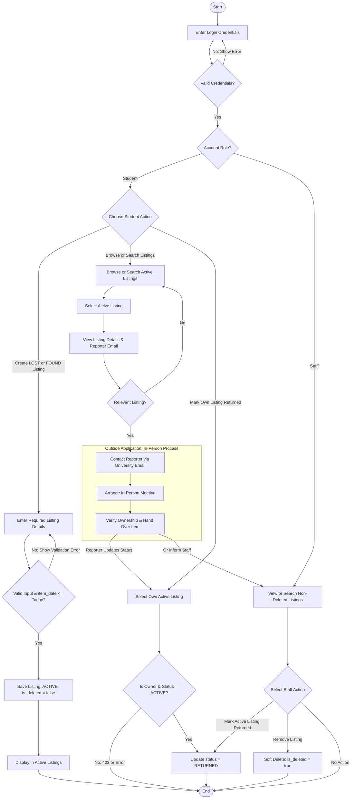

# Find My — Activity Diagram

The flowchart below models the complete end-to-end workflow of the Find My application, aligned with `docs/SRS.md` and `docs/user-stories.md` (US1–US7).

### Diagram Notes
* **Authentication & Role Detection (US1):** Failed logins loop back with a generic error; valid logins automatically route users based on their stored `STUDENT` or `STAFF` role.
* **Unified Listing Creation (US2 & US3):** Both `LOST` and `FOUND` listings pass through the same validation check (`E1`) before saving with `status = ACTIVE` and `is_deleted = false`.
* **Student Ownership Management (US7):** Students can mark their own `ACTIVE` listings as `RETURNED`, either directly from their menu or after an in-person handover.
* **Staff Moderation (US6):** Staff can view all non-deleted listings (`ACTIVE` and `RETURNED`), mark any active listing as `RETURNED`, or soft-delete inappropriate listings (`is_deleted = true`).
* **System Boundary:** Email communication, physical ownership verification, and item handover occur strictly outside the software.
