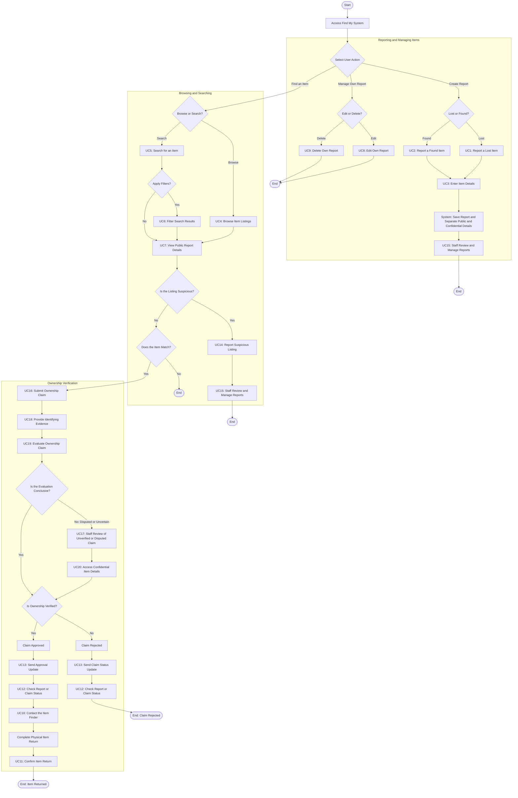

# Find My — Activity Diagram

## 1. Overview

This document describes the activity diagram for **Find My**, a university lost-and-found system. It represents the main workflows, decisions, and interactions between students/users, the Find My System, and authorized university staff.

The diagram covers the processes associated with use cases UC1–UC20 defined in the project's Use Case Diagram.

## 2. Actors and Responsibilities

- **Student / User:** Reports lost or found items, searches listings, views item details, manages personal reports, submits ownership claims, provides identifying evidence, receives status updates, contacts the finder, and participates in the item return process.
- **Find My System:** Stores reports, separates public information from confidential details, evaluates ownership claims, and sends status updates without revealing sensitive information.
- **Authorized University Staff:** Reviews reports, investigates unverified or disputed ownership claims, accesses confidential item details when authorized, and confirms completed item returns.

## 3. Activity Diagram

The following Mermaid diagram illustrates the main workflows of the Find My system.

## 4. Design Decisions and Rules

### 4.1 Report Creation

Creating a lost-item report (UC1) or a found-item report (UC2) is followed by entering item details (UC3). The system stores public information separately from confidential identifying details.

### 4.2 Report Management

Users can edit (UC8) or delete (UC9) only their own reports. These actions are separate from creating a new report.

### 4.3 Ownership Claims

Submitting an ownership claim (UC16) requires identifying evidence (UC18). The system evaluates the claim (UC19) using confidential item details.

### 4.4 Manual Review

When automated evaluation is inconclusive or a claim is disputed, authorized staff review it (UC17) and access confidential item details (UC20) as necessary.

### 4.5 Privacy and Status Updates

Public listing details must not expose confidential information. Claim updates (UC13) must not disclose sensitive details or reveal which individual fields matched.

### 4.6 Item Return

Only an approved ownership claim proceeds to contacting the finder (UC10), physical item handover, and return confirmation (UC11).

## 5. Rendering and Viewing

- GitHub supports Mermaid diagrams inside Markdown files and can display the diagram directly.
- To render the diagram using PlantUML, save the PlantUML source in a separate file named `activity-diagram.puml` and open it with a PlantUML-compatible renderer, such as the PlantUML extension in Visual Studio Code.
- Keep this document at `docs/activity-diagram.md` in the repository.

## 6. Scope

This is an initial activity model of the main Find My workflows. It is intended to clarify the system's behavior and decisions before implementation. The details should be reviewed against the team's final Use Case Diagram and requirements.

