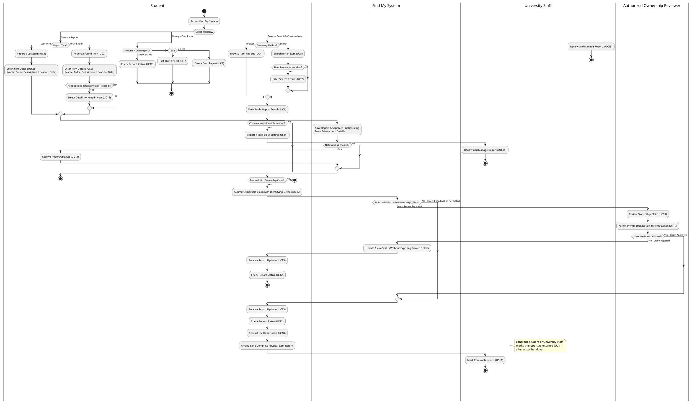
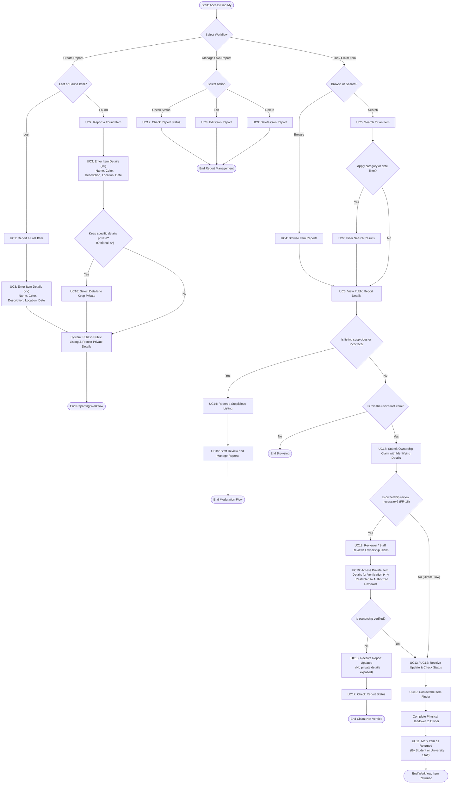

# Find My — Activity Diagram

## 1. Purpose

This document describes the main operational workflows for **Find My**, a university lost-and-found system. It is aligned with the functional requirements (`FR-01` through `FR-19`), user stories (`User Story 1` through `User Story 18`), and the Use Case Diagram (`UC1` through `UC19`) defined in the system specifications.

The diagram models the end-to-end activities and decision points for reporting lost and found items, hiding private item details, browsing and searching public listings, managing reports, verifying ownership claims, and marking items as returned.

## 2. Actors and Swimlanes

- **Student** — initiates report creation (`UC1`, `UC2`, `UC3`), optionally selects found-item details to keep private (`UC16`), browses/searches/filters listings (`UC4`, `UC5`, `UC7`), views public report details (`UC6`), manages their own reports (`UC8`, `UC9`), checks status or receives updates (`UC12`, `UC13`), flags suspicious listings (`UC14`), submits ownership claims with identifying details (`UC17`), contacts the finder (`UC10`), and marks an item as returned (`UC11`).
- **Find My System** — stores reports while keeping public and private details separated, serves public listings, and dispatches report updates (`UC13`) when notifications are enabled without exposing private details.
- **Authorized Ownership Reviewer** — reviews ownership claims when necessary (`UC18`) and accesses private item details for verification (`UC19`), as permitted by `FR-18` and `FR-19`.
- **University Staff** — reviews and manages reports (`UC15`), may act as an authorized reviewer for ownership claims (`UC18`), and marks reports as returned (`UC11`) once the item is given back to its owner.

## 3. Activity Diagram (PlantUML)

The following PlantUML code defines the workflow, utilizing swimlanes to map actions to their respective actors.

## 4. Activity Diagram (Mermaid)

The following flowchart represents the system workflow in Mermaid format.

## 5. Activity Step Summary

| Activity Node | Actor / Swimlane | Description | Related Use Case |
|---|---|---|---|
| Report a Lost / Found Item | Student | Initiates creation of a lost or found report. | `UC1`, `UC2` |
| Enter Item Details | Student | Mandatory step (`<<include>>`) capturing item name, color, description, location, and date. | `UC3` |
| Select Details to Keep Private | Student | Optional step (`<<extend>>` on `UC2`) hiding sensitive attributes from public listings. | `UC16` |
| Browse / Search / Filter Reports | Student | Explores public reports via recent listings, keyword search, or filters. | `UC4`, `UC5`, `UC7` |
| View Public Report Details | Student | Displays only the public fields of a report. | `UC6` |
| Report a Suspicious Listing | Student | Flags incorrect or suspicious report content for staff review. | `UC14` |
| Review and Manage Reports | University Staff | Staff inspect, moderate, and manage submitted reports. | `UC15` |
| Edit / Delete Own Report | Student | Modifies or removes a report created by the user. | `UC8`, `UC9` |
| Submit Ownership Claim | Student | Submits a claim along with identifying details to establish ownership. | `UC17` |
| Review Ownership Claim | Authorized Ownership Reviewer | Reviews the submitted claim when necessary before an item is returned. | `UC18` |
| Access Private Item Details | Authorized Ownership Reviewer | Mandatory sub-step (`<<include>>` of `UC18`) accessing hidden details to verify a claim. | `UC19` |
| Check Status / Receive Updates | Student / System | Tracks report progress and delivers notifications without exposing private details. | `UC12`, `UC13` |
| Contact the Item Finder | Student | Connects with the finder to arrange the physical return of the item. | `UC10` |
| Mark Item as Returned | Student / University Staff | Updates the report state to returned only after the item has physically been given back. | `UC11` |

## 6. Relationship and Control-Flow Notes

- **`<<include>>` — `UC1` to `UC3` and `UC2` to `UC3`:** In the activity flow, both `UC1` and `UC2` transition unconditionally into `UC3` because entering item details is required for every report.
- **`<<extend>>` — `UC16` to `UC2`:** Modeled as a conditional decision branch immediately following found-item entry (`UC2`/`UC3`), allowing the finder to mark specific details as private before the listing is published.
- **`<<include>>` — `UC18` to `UC19`:** Whenever the workflow enters `UC18` (Review Ownership Claim), it sequentially executes `UC19` (Access Private Item Details for Verification) within the Authorized Ownership Reviewer swimlane.

## 7. Scope and Privacy Notes

1. **Separation of Public and Private Details:** `UC6` exposes only public report details. Any private details selected during `UC16` remain hidden from general users.
2. **Restricted Verification Access:** `UC19` is strictly isolated within the `Authorized Ownership Reviewer` swimlane (`FR-19`). Submitting a claim (`UC17`) never grants the claimant visibility into the stored private details.
3. **Conditional Claim Review:** In accordance with `FR-18`, the decision node preceding `UC18` reflects that ownership claims are reviewed *when necessary*, rather than forcing mandatory staff intervention on every single claim.
4. **Actual Return Prerequisite:** `UC11` (Mark Item as Returned) is placed strictly at the end of the handover flow after the physical item has been returned to its owner.
5. **Notification Privacy:** Updates sent via `UC13` notify users of new activity without leaking private item details or verification evidence.
6. **Ownership Boundaries:** `UC8` (Edit) and `UC9` (Delete) are restricted to reports owned by the authenticated student.

## 8. Traceability Note

This activity diagram covers all 19 functional use cases (`UC1`–`UC19`) mapped to `FR-01` through `FR-19` and `User Story 1` through `User Story 18` in the system requirements specification.
