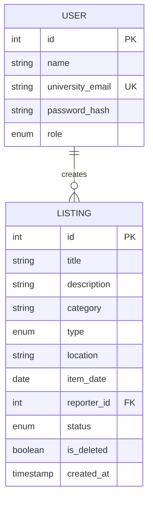
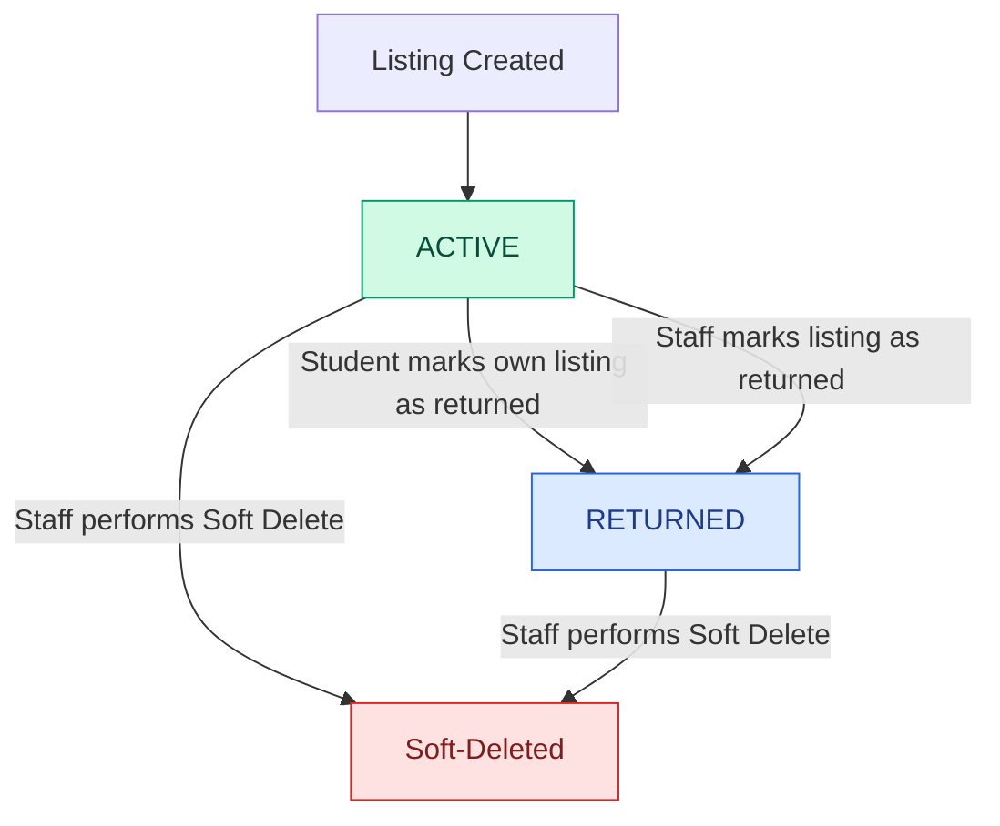

# Find My — Data Model

## 1. Overview

The Find My system uses two main entities:

- **User:** Represents a registered university user with either the `STUDENT` or `STAFF` role.
- **Listing:** Represents an item reported as lost or found by a Student.

A single `Listing` entity is used for both LOST and FOUND reports. The `type` attribute distinguishes between them.

The reporter's contact information is retrieved through the relationship between `Listing.reporter_id` and `User.id`. Therefore, contact information is not duplicated in the `Listing` entity.

## 2. Entity Relationship Diagram (ERD)



### Relationship Description

- One `User` can create zero or multiple `Listing` records.
- Each `Listing` must belong to exactly one `User`.
- The relationship is implemented through `Listing.reporter_id`, which references `User.id`.
- Only users with the `STUDENT` role can create listings.
- Staff members can manage listings but cannot create LOST or FOUND listings.

**Relationship Cardinality:**

`User (1) ───────── (0..N) Listing`

## 3. Entity Definitions

### 3.1 User Entity

The `User` entity stores registered university account information and determines the permissions available to each user.

| Attribute | Data Type | Constraints | Description |
|---|---|---|---|
| `id` | Integer | Primary Key | Unique identifier of the user |
| `name` | String | Required, maximum 100 characters | User's full name |
| `university_email` | String | Required, Unique after normalization, maximum 255 characters | University email used for authentication and contact. Stored trimmed and in lowercase. |
| `password_hash` | String | Required, stores a password hash | Securely stored password hash. The `password` value entered at login is compared against this field. |
| `role` | Enum | Required: `STUDENT`, `STAFF` | Determines the user's access permissions |

**Business Rules:**

- Every user must have a unique university email, checked on the normalized (trimmed, lowercase) value.
- Login email matching is case-insensitive and ignores leading and trailing whitespace.
- Passwords must be stored as secure hashes, never as plain text.
- The user's role is automatically detected from the `User` record after successful authentication.
- Users cannot change their assigned role through the application.
- Only registered university accounts can log in.

### 3.2 Listing Entity

The `Listing` entity stores information about items reported as lost or found.

Both LOST and FOUND reports are stored in this entity and are distinguished by the `type` attribute.

| Attribute | Data Type | Constraints | Description |
|---|---|---|---|
| `id` | Integer | Primary Key | Unique identifier of the listing |
| `title` | String | Required, 3–100 characters | Title of the reported item |
| `description` | String | Required, 1–500 characters | Description of the item |
| `category` | String / Enum | Required, predefined values | Category of the reported item |
| `type` | Enum | Required: `LOST`, `FOUND` | Specifies whether the item is lost or found |
| `location` | String | Required, 2–100 characters | Campus location where the item was lost or found |
| `item_date` | Date | Required, valid date on or before the current date | Date the item was lost or found |
| `reporter_id` | Integer | Foreign Key → `User.id`, Required | Identifies the Student who created the listing |
| `status` | Enum | Required: `ACTIVE`, `RETURNED`; default: `ACTIVE` | Current state of the listing |
| `is_deleted` | Boolean | Required; default: `false` | Indicates whether the listing has been soft-deleted |
| `created_at` | Timestamp | Required, automatically generated | Date and time when the listing was created in the system |

**Business Rules:**

- Only authenticated Students can create listings.
- Every listing must be associated with its creator through `reporter_id`.
- New listings must have `status = ACTIVE`.
- New listings must have `is_deleted = false`.
- The `created_at` timestamp is generated automatically by the system.
- The `item_date` must be a valid date and cannot be in the future.
- The `item_date` and `created_at` represent different concepts:
  - `item_date`: When the item was lost or found.
  - `created_at`: When the listing was submitted to the system.

## 4. Enumerations and Fixed Values

### 4.1 User Role

The `role` attribute determines the permissions assigned to each user.

| Value | Description |
|---|---|
| `STUDENT` | A university student who can create listings, browse and search active listings, and manage their own listing status. |
| `STAFF` | A university staff member who can view and manage non-deleted listings. |

### 4.2 Listing Type

The `type` attribute distinguishes lost and found reports.

| Value | Description |
|---|---|
| `LOST` | An item reported as lost by a Student. |
| `FOUND` | An item reported as found by a Student. |

### 4.3 Listing Category

The `category` attribute must contain one of the following predefined values:

| Value |
|---|
| `Electronics` |
| `Documents` |
| `Clothing` |
| `Accessories` |
| `Other` |

Each category value is a fixed constant. Implementations may store it as an enumeration (for example `ELECTRONICS` in the class diagram), but the displayed label must match the names above.

### 4.4 Listing Status

The `status` attribute represents the current state of a listing.

| Value | Description |
|---|---|
| `ACTIVE` | The listing is active and can be displayed to Students. |
| `RETURNED` | The item has been marked as returned and is no longer displayed in Student browsing and search results. |

The `is_deleted` attribute is independent of `status` and represents whether a listing has been soft-deleted.

## 5. Data Validation Constraints

The system must validate listing data before saving it.

| Attribute | Validation Rule |
|---|---|
| `title` | Required; 3–100 characters after trimming leading and trailing whitespace |
| `description` | Required; 1–500 characters after trimming leading and trailing whitespace |
| `category` | Required; must match one of the predefined categories |
| `location` | Required; 2–100 characters after trimming leading and trailing whitespace |
| `item_date` | Required; must be a valid calendar date on or before the current date |
| `type` | Required; only `LOST` or `FOUND` |
| `reporter_id` | Required; must reference an existing user who is a Student |
| `status` | Required; only `ACTIVE` or `RETURNED` |
| `is_deleted` | Required; Boolean value |

If any required field is missing or invalid:

- The system rejects the submission.
- A validation error is displayed.
- The invalid listing is not saved.

## 6. Listing Lifecycle

A listing is initially created with the following values:

```text
status = ACTIVE
is_deleted = false
created_at = current server timestamp
```

A listing can later be marked as returned by its owner (Student) or by Staff.



**Important Rules:**

- Only the Student who created a listing can mark their own listing as returned.
- Staff can mark any active listing as returned.
- Only Staff can soft-delete listings.
- An already returned listing cannot be marked as returned again.
- A soft-deleted listing cannot be managed through the application.
- Soft deletion does not permanently remove the database record.

## 7. Listing Visibility Rules

Listing visibility depends on both `status` and `is_deleted`.

| Listing State | Student Browse & Search | Student Details View | Student Status Update | Staff Management View | Database Record |
|---|---|---|---|---|---|
| `ACTIVE`, `is_deleted = false` | Visible | Viewable | Own listings only | Visible | Stored |
| `RETURNED`, `is_deleted = false` | Hidden | Blocked | Not allowed | Visible | Stored |
| `is_deleted = true` | Hidden | Blocked | Not allowed | Hidden | Stored |

**Additional Rules:**

- Students can only browse and search active, non-deleted listings.
- Staff can view and search both active and returned listings, provided they are not soft-deleted.
- Soft-deleted listings are hidden from all Student and Staff views.
- Returned listings remain stored and visible to Staff.

## 8. Data Relationships and Integrity

The relationship between `User` and `Listing` must preserve data integrity.

### 8.1 Primary Keys

- `User.id` uniquely identifies each user.
- `Listing.id` uniquely identifies each listing.

### 8.2 Foreign Key

- `Listing.reporter_id` references `User.id`.
- Every listing must have a valid reporter.
- The reporter must have the `STUDENT` role when the listing is created.

### 8.3 Unique Constraint

- `User.university_email` must be unique after normalization (trimmed and lowercased).
- Email matching during login must be case-insensitive and ignore leading and trailing whitespace.

### 8.4 Data Retention

- Soft-deleted listings remain stored in the database.
- The application must not permanently delete listings through the Staff management interface.
- Returned listings also remain stored in the database.

## 9. Design Notes

- The system uses one `Listing` entity for both LOST and FOUND reports.
- The `type` attribute distinguishes between LOST and FOUND listings.
- The `status` attribute represents whether an item is active or returned.
- The `is_deleted` attribute implements Soft Delete independently of listing status.
- The `reporter_id` foreign key connects each listing to its creator.
- The reporter's email is retrieved from the related `User` record rather than being duplicated in `Listing`.
- Database technology and implementation-specific data types will be selected during the implementation phase.

---

*Find My — Making lost and found easier within the university community.*
