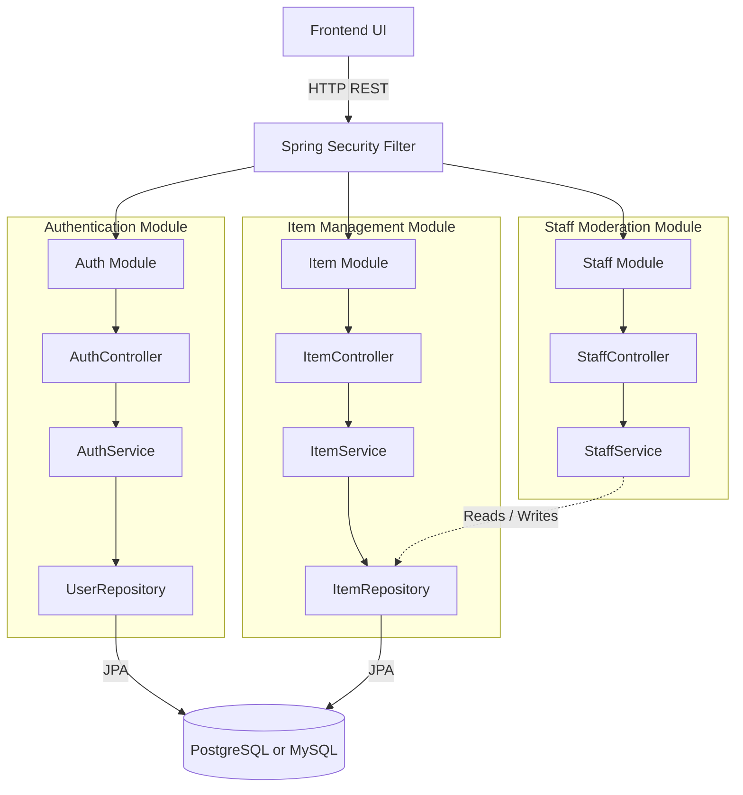

# Find My — Software Architecture Document

## 1. Architectural Pattern: Modular Monolith

For the **Find My** MVP, the team has chosen a **Modular Monolithic Architecture** (Package-by-Feature).

### Why a Modular Monolith?

* **MVP Fit:** It keeps the entire application in a single deployment and one database, avoiding the massive infrastructure overhead of microservices while providing a clean separation of concerns.
* **Team Isolation:** By grouping code by feature domain (`Auth`, `Item`, `Staff`) rather than by technical layer (`Controllers`, `Services`), the three team members can work on different features simultaneously with minimal merge conflicts.
* **Future-Proofing:** Distinct modules with strict boundaries are much easier to test and can be cleanly extracted into separate services later if the application needs to scale.

---

## 2. High-Level Architecture Diagram

The system is divided into vertical feature modules. Inside each module, the architecture strictly respects the standard flow: Presentation -> Business Logic -> Persistence.

---

## 3. Module Boundaries & Responsibilities

### 3.1. Authentication Module (`Auth`)

* **Responsibility:** Handles login and user identity.
* **Presentation (Interacts with User):** `AuthController` receives login credentials via HTTP requests.
* **Business Logic (Enforces Rules):** `AuthService` verifies credentials and issues session tokens or sets security context.
* **Data Access (Reads/Writes Data):** `UserRepository` fetches pre-provisioned user data from the database.

### 3.2. Item Management Module (`Item`)

* **Responsibility:** Handles student-facing lost and found reporting and searching.
* **Presentation (Interacts with User):** `ItemController` receives report submissions, parses JSON/forms, and accepts search queries.
* **Business Logic (Enforces Rules):** `ItemService` enforces domain rules (e.g., ensuring `item_date <= today`, boundary lengths, setting `type` to LOST or FOUND).
* **Data Access (Reads/Writes Data):** `ItemRepository` reads and writes `Item` records, strictly filtering query results by `status = ACTIVE` and `is_deleted = false`.

### 3.3. Staff Moderation Module (`Staff`)

* **Responsibility:** Handles administrative management of listings.
* **Presentation (Interacts with User):** `StaffController` receives management requests from staff UI views.
* **Business Logic (Enforces Rules):** `StaffService` ensures the requester has the `STAFF` role, then enforces business logic for soft-deletion (`is_deleted = true`) or status changes (`RETURNED`).
* **Data Access (Reads/Writes Data):** Borrows from `ItemRepository` but uses broader queries (`is_deleted = false` only) to view all active and returned items.

---

## 4. End-to-End Trace (User Story 2: Report Lost Item)

This trace demonstrates how a request flows through the **Item Management Module**, tracking user input, business rule validation, and data storage.

### 4.1. Success Scenario

1. **User Interaction (Presentation Layer):** The student fills out the reporting form and submits a `POST /api/items/lost`. `ItemController` receives the HTTP request and checks that all required fields are present in the payload.
2. **Rule Enforcement (Business Logic Layer):** `ItemController` passes the data to `ItemService`. The service enforces domain rules:
   * Trims whitespace from text fields.
   * Verifies `item_date` is not in the future.
   * Sets default lifecycle flags: `status = ACTIVE`, `is_deleted = false`, `created_at = now()`.
   * Attaches the `reporter_id` based on the authenticated session.
3. **Information Storage (Data Access Layer):** `ItemService` passes the validated, complete object to `ItemRepository`, which executes the `INSERT INTO` SQL command. The database saves the item, and the Controller returns a `201 Created` response to the user.

### 4.2. Error Scenario (Invalid Date)

1. **User Interaction:** The student submits the form, but selects a future date for `item_date`.
2. **Rule Enforcement:** `ItemController` passes the payload to `ItemService`. The service detects that `item_date > today` and immediately throws an `InvalidDateException`.
3. **Information Storage:** `ItemRepository` is **never** called. No data reaches the database.
4. **System Response:** A global exception handler or `ItemController` catches the exception and returns an `HTTP 400 Bad Request` with the message *"Date cannot be in the future"* so the UI can display the error to the student.
