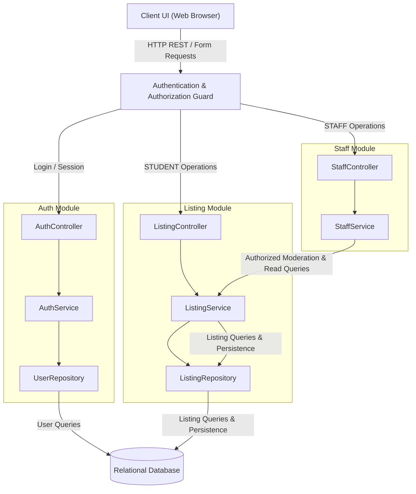

# Find My — Software Architecture Document

## 1. Architectural Pattern: Modular Monolith

For the **Find My** MVP, the system follows a **Modular Monolithic Architecture** (Package-by-Feature), organized into three primary feature modules: **Authentication (`Auth`)**, **Listing Management (`Listing`)**, and **Staff Moderation (`Staff`)**[cite: 2].

### Why a Modular Monolith?
* **MVP Fit:** Keeps deployment and data storage unified in a single application and relational database, avoiding distributed-system overhead while maintaining clear domain boundaries[cite: 2].
* **Parallel Team Work:** Grouping components by feature domain rather than technical layer reduces merge conflicts when multiple developers work across modules[cite: 2].
* **Maintainability & Evolution:** Clear module boundaries support focused testing and make future refactoring or extraction easier if requirements grow[cite: 2].

---

## 2. High-Level Architecture Diagram

Each feature module follows a layered internal flow (**Presentation → Business Logic → Data Access**), while cross-cutting authentication/authorization guards requests before reaching protected module operations[cite: 2].

---

## 3. Module Boundaries, Interactions & Responsibilities

### 3.1. Authentication Module (`Auth`)
* **Responsibility:** Authenticates registered university accounts using normalized `university_email` (trimmed, case-insensitive) and `password` verified against `password_hash`, automatically detecting `STUDENT` or `STAFF` role[cite: 2].
* **Presentation (`AuthController`):** Accepts login requests, rejects empty/whitespace-only inputs, and returns generic credential failure responses without revealing which field was invalid[cite: 2].
* **Business Logic (`AuthService`):** Validates credentials, normalizes email lookup, resolves the stored role, and establishes an authenticated session or token context (exact session/token mechanism and password-hashing algorithm are selected during implementation)[cite: 2].
* **Data Access (`UserRepository`):** Reads `User` records and provides reporter contact lookup (`university_email`) via `reporter_id` without exposing `password_hash` or private account fields[cite: 2].

### 3.2. Listing Management Module (`Listing`)
* **Responsibility:** Handles `LOST` and `FOUND` `Listing` creation, browsing, keyword searching, viewing details, and a Student marking **their own** `ACTIVE` listing as `RETURNED`[cite: 2].
* **Presentation (`ListingController`):** Handles listing creation (`POST`), active listing browse/search (`GET`), listing detail retrieval (`GET`), and owner status updates to `RETURNED`[cite: 2].
* **Business Logic (`ListingService`):** Enforces field trimming and length/category/`item_date <= today` rules, initializes `status = ACTIVE`, `is_deleted = false`, and `created_at`, enforces ownership on Student `RETURNED` transitions, and applies `BR12` check order[cite: 2].
* **Data Access (`ListingRepository`):** Persists and queries `Listing` records, filtering Student browse/search/details strictly to `status = ACTIVE` and `is_deleted = false`[cite: 2].

### 3.3. Staff Moderation Module (`Staff`)
* **Responsibility:** Allows authenticated `STAFF` users to view/search all non-deleted listings (`is_deleted = false`, both `ACTIVE` and `RETURNED`), mark any active listing as `RETURNED`, and soft-delete inappropriate or invalid listings (`is_deleted = true`)[cite: 2].
* **Presentation (`StaffController`):** Exposes Staff moderation endpoints/views and enforces `STAFF` role authorization[cite: 2].
* **Business Logic (`StaffService`):** Enforces `STAFF`-only access, validates target listing existence and lifecycle state (`BR12`), and executes `RETURNED` transitions or soft deletion (`is_deleted = true`)[cite: 2].
* **Interaction Contract with `Listing` Module:** Rather than bypassing business rules with direct unguarded writes, `StaffService` interacts through `ListingService` (or shared `Listing` domain read/write operations) so `BR12` validation order, soft-delete semantics (`is_deleted = true`), and `RETURNED` state rules remain consistent in one place[cite: 2].

---

## 4. Authentication, API & Error Contract, and Concurrency

### 4.1. Authentication & Session Management
* Unauthenticated requests to protected web pages redirect to the login view; unauthenticated requests to protected API operations return **HTTP `401 Unauthorized`**[cite: 2].
* Session/token handling, password hashing, and database choice are finalized during implementation while strictly enforcing `FR1–FR5`, `FR32–FR35`, and `NFR1–NFR2`[cite: 2].

### 4.2. Standard Responses & Error Handling (`BR12` Precedence)
* **Validation Errors (`400 Bad Request`):** Missing/invalid fields or `item_date` in the future during creation; invalid/empty login fields; or attempting to mark an already `RETURNED` listing as returned[cite: 2].
* **Unauthorized (`401 Unauthorized`):** Unauthenticated access to protected API operations[cite: 2].
* **Forbidden (`403 Forbidden`):** Authenticated `STUDENT` attempting a `STAFF`-only operation, or a `STUDENT` attempting to modify another user's `Listing`[cite: 2].
* **Not Found (`404 Not Found`):** Target `Listing` does not exist or has `is_deleted = true` when performing management updates (`BR12`), or unavailable/non-active listing requested in Student detail view (displaying `"Listing not found or no longer available"`)[cite: 2].

### 4.3. Transactions & Concurrency Control
* State-changing operations (creating a `Listing`, marking `status = RETURNED`, and setting `is_deleted = true`) run inside **transactional** boundaries so partial updates are never committed[cite: 2].
* Concurrent updates (such as two requests trying to mark the same `Listing` as `RETURNED` or soft-delete it simultaneously) are serialized at the transaction/database level and re-checked against current persisted state so `is_deleted` records are preserved and invalid duplicate transitions are rejected cleanly[cite: 2].

---

## 5. End-to-End Trace (User Story 2: Report Lost Item)

### 5.1. Success Scenario
1. **Presentation (`ListingController`):** An authenticated `STUDENT` submits a lost item report (`type = LOST`) with `title`, `description`, `category`, `location`, and `item_date`[cite: 2].
2. **Business Logic (`ListingService`):** Trims text fields, validates lengths, category, and `item_date <= today`, attaches `reporter_id`, and sets `status = ACTIVE`, `is_deleted = false`, and `created_at`[cite: 2].
3. **Data Access (`ListingRepository` & DB):** Saves the new `Listing` transactionally and returns the created record so it immediately appears in active listings[cite: 2].

### 5.2. Error Scenario (Invalid `item_date`)
1. **Presentation (`ListingController`):** Receives a submission where `item_date` is after the current date[cite: 2].
2. **Business Logic (`ListingService`):** Rejects the input due to `BR4` / `FR8` without calling persistence to insert a new row[cite: 2].
3. **Response:** Returns a validation error (`HTTP 400 Bad Request`) without saving the listing[cite: 2].
