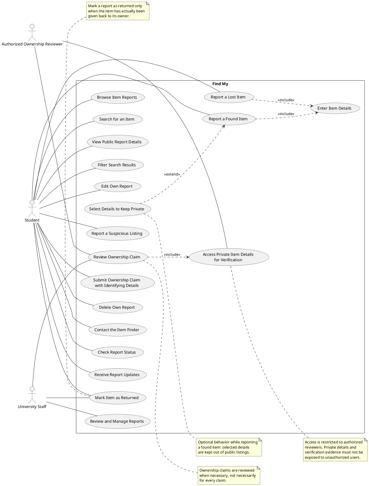

# Find My — Use Case Diagram

## 1. Purpose

This document describes the main use cases for **Find My**, a university lost-and-found system. It is based on the functional requirements and user stories in `SRS.md`.

The diagram covers reporting lost and found items, browsing and searching reports, report management, notifications, and ownership verification while protecting private item details.

## 2. Actors

- **Student** — reports lost or found items, browses and searches reports, manages their own reports, contacts a finder, checks status, and submits an ownership claim.
- **University Staff** — reviews and manages reports and may review ownership claims.
- **Authorized Ownership Reviewer** — a person authorized to review an ownership claim when necessary. This may be a university staff member or another authorized person, as allowed by FR-18.

Private item details must only be accessible to authorized users (FR-19). The exact verification process and the staff members responsible for it remain subject to further analysis, as stated in `SRS.md`.

## 3. Use Case Diagram (PlantUML)

The following code can be rendered directly by GitHub-compatible PlantUML tooling or pasted into a PlantUML renderer.

## 4. Use Case Summary

| Use Case | Description | Related Requirements / Stories |
|---|---|---|
| UC1 — Report a Lost Item | A student creates a report for an item they have lost. | FR-01; User Story 1 |
| UC2 — Report a Found Item | A student creates a report for an item they have found. | FR-02; User Story 2 |
| UC3 — Enter Item Details | The reporter enters details such as name, color, description, location, and date. | FR-03; User Story 3 |
| UC4 — Browse Item Reports | A user views the list of lost and found reports, including recent reports. | FR-04; User Story 7 |
| UC5 — Search for an Item | A user searches for reports using an item name or other publicly available details. | FR-05; User Story 4 |
| UC6 — View Public Report Details | A user views the public information for a report. | FR-06; User Story 6 |
| UC7 — Filter Search Results | A user filters results by category or date. | FR-07; User Story 5 |
| UC8 — Edit Own Report | A user edits a report they own. | FR-08; User Story 8 |
| UC9 — Delete Own Report | A user deletes a report they own, subject to applicable record rules. | FR-09; User Story 9 |
| UC10 — Contact the Item Finder | A student contacts the person who reported finding an item to arrange its return. | FR-10; User Story 10 |
| UC11 — Mark Item as Returned | A user or staff member marks a report as returned after the item has been given back. | FR-11; User Story 11 |
| UC12 — Check Report Status | A user checks the status of their report. | FR-12; User Story 12 |
| UC13 — Receive Report Updates | A user receives notifications when there is new information about their report, if notifications are enabled. | FR-13; User Story 13 |
| UC14 — Report a Suspicious Listing | A user reports incorrect or suspicious information in a listing. | FR-14; User Story 14 |
| UC15 — Review and Manage Reports | University staff review and manage lost-and-found reports. | FR-15; User Story 15 |
| UC16 — Select Details to Keep Private | While reporting a found item, a student selects details that should not be displayed publicly. | FR-16; User Story 16 |
| UC17 — Submit Ownership Claim with Identifying Details | A person claiming an item submits identifying details to help establish ownership. | FR-17; User Story 17 |
| UC18 — Review Ownership Claim | An authorized reviewer reviews an ownership claim when necessary before the item is returned. | FR-18; User Story 18 |
| UC19 — Access Private Item Details for Verification | An authorized reviewer accesses private report details when needed to assess an ownership claim. | FR-19; User Stories 16–18 |

## 5. Relationship Notes

- **`<<include>>` — UC1 to UC3 and UC2 to UC3:** entering item details is a required part of creating either kind of report.
- **`<<extend>>` — UC16 to UC2:** selecting details to keep private is an optional behavior during a found-item report.
- **`<<include>>` — UC18 to UC19:** reviewing a claim may require authorized access to private item details for verification. Access must remain restricted under FR-19.

## 6. Scope and Privacy Notes

1. Public report details and private item details are distinct. UC6 exposes only public details.
2. UC19 is restricted to an authorized ownership reviewer. A person claiming an item submits identifying details through UC17 but does not automatically gain access to the private details used for verification.
3. UC18 is conditional: FR-18 says claims should be reviewed when necessary. The diagram does not require staff review for every claim.
4. UC11 records that the item has actually been returned. The SRS does not define a complete return-confirmation workflow.
5. The exact ownership-verification procedure and the assignment of responsibility remain undecided in the current SRS.
6. Notifications in UC13 must not disclose private item details or identifying evidence to unauthorized users.
7. UC8 and UC9 apply only to the user's own reports.

## 7. Traceability Note

The diagram represents the use cases supported by FR-01 through FR-19 and User Stories 1 through 18. Non-functional requirements such as usability, performance, reliability, maintainability, privacy, and security apply across the system and are therefore not represented as separate user-goal use cases.
